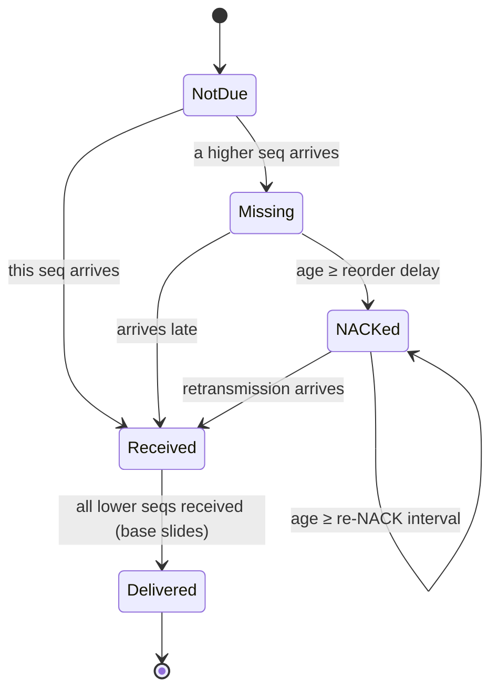
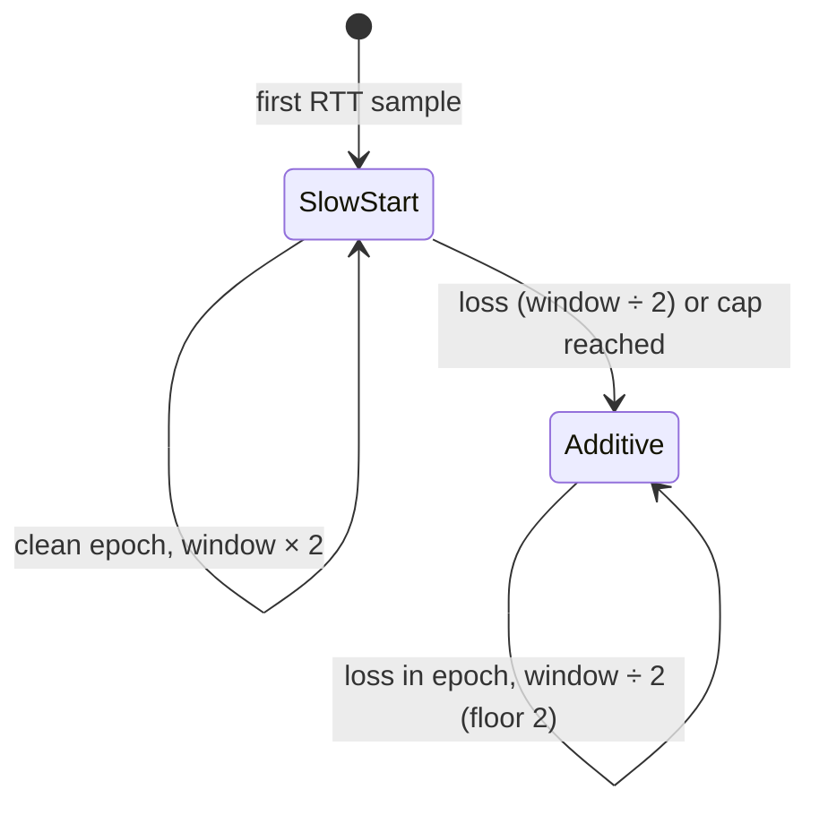
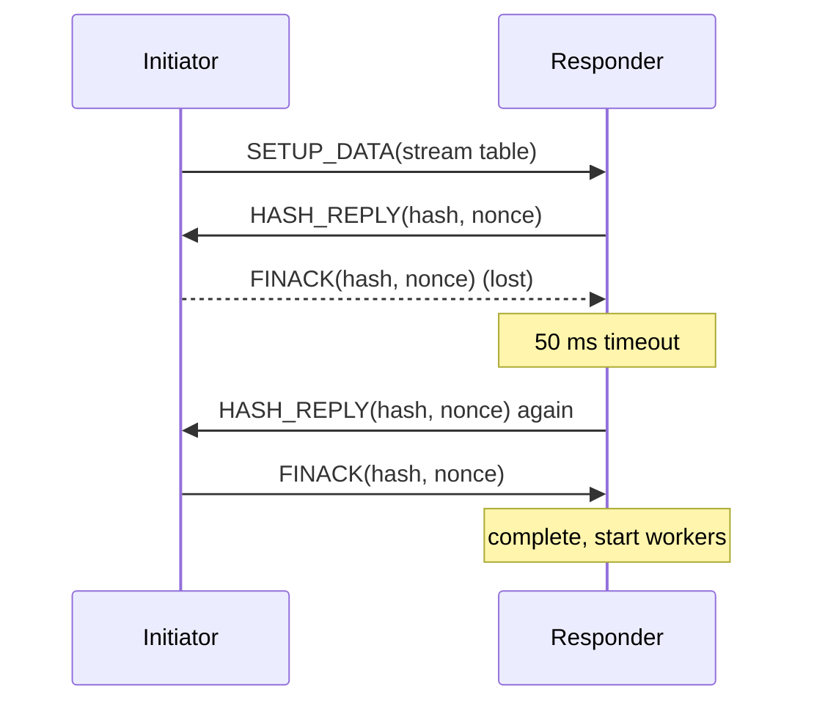
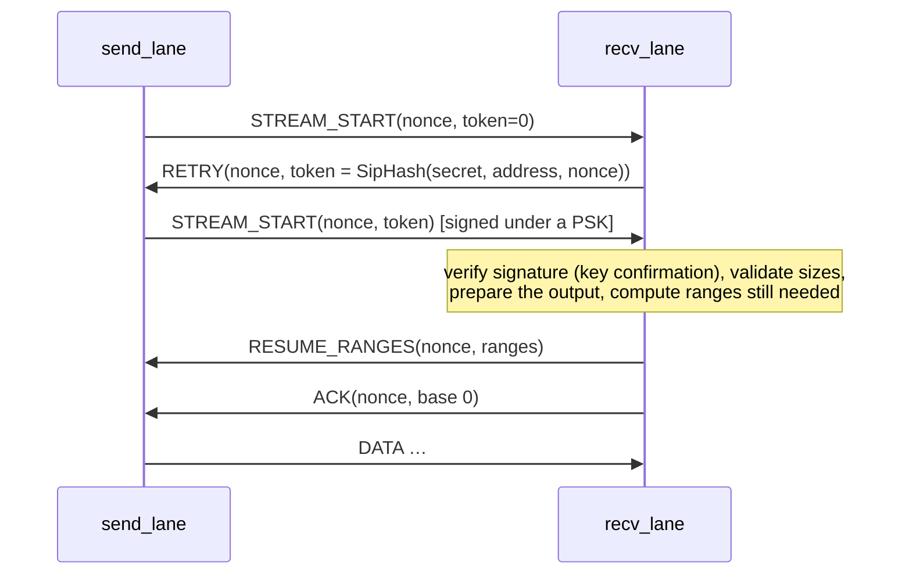
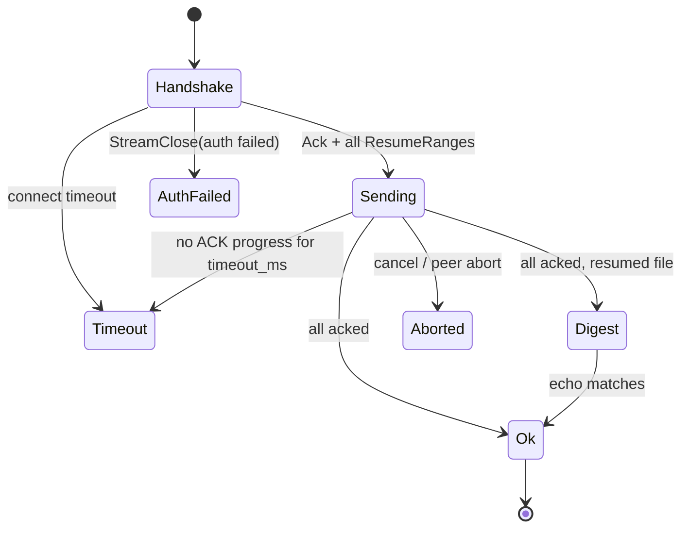

# Fuse: a per-stream transport protocol over UDP — project report

*Repository: [kamalkoushikd/fuse-nw](https://github.com/kamalkoushikd/fuse-nw) · protocol version 8 ·
project version 0.2.0*

This report documents the whole repository: the problem the project addresses, the design that answers it,
how the code is organised and written, how a packet travels end to end, how the protocol was hardened in its
version 8, how it was tested, what the measurements show, and what is still missing. File references are
relative to the repository root; `file.cpp:123` means a line in that file.

---

## Contents

1. [Problem statement](#1-problem-statement)
2. [Background: why TCP and QUIC are not enough](#2-background-why-tcp-and-quic-are-not-enough)
3. [Goals and non-goals](#3-goals-and-non-goals)
4. [Approach in one page](#4-approach-in-one-page)
5. [Repository map](#5-repository-map)
6. [Architecture](#6-architecture)
7. [The wire format](#7-the-wire-format)
8. [Building blocks](#8-building-blocks)
9. [The three transports](#9-the-three-transports)
10. [The life of one packet](#10-the-life-of-one-packet)
11. [Security model and the v8 hardening](#11-security-model-and-the-v8-hardening)
12. [Engineering principles](#12-engineering-principles)
13. [Testing](#13-testing)
14. [Evaluation](#14-evaluation)
15. [Limitations and future work](#15-limitations-and-future-work)
16. [Building, running and reproducing](#16-building-running-and-reproducing)
17. [Glossary](#17-glossary)
18. [Appendix A. File-by-file guide](#appendix-a-file-by-file-guide)
19. [Appendix B. Configuration and status reference](#appendix-b-configuration-and-status-reference-fusetransferhpp)

---

## 1. Problem statement

Many systems send two very different kinds of data between the same pair of hosts at the same time:

- **Loss-tolerant, latency-sensitive streams**: telemetry, sensor samples, control signals, game state.
  A sample that arrives late is worthless; a newer one supersedes it. These streams want *low and steady
  delay* and would rather drop data than wait for it.
- **Loss-intolerant, throughput-sensitive streams**: file and model transfers, logs, bulk state. Every byte
  must arrive, in a known place, as fast as the path allows.

The problem this project addresses is:

> **How do we carry both kinds of traffic over one session between two hosts, so that each stream gets the
> delivery guarantees it actually needs, a burst of bulk data or a loss on one stream does not delay or slow
> down the others, and the whole thing is fast enough to saturate a modern link — without adopting the
> fixed trade-offs of TCP or QUIC?**

Concretely, the transport must:

1. deliver a loss-intolerant stream reliably and in its correct place, at high throughput;
2. keep a loss-tolerant stream's latency flat even while a bulk transfer saturates the same session;
3. let each stream choose its own policy (reliable or not, ordered or not, coalescing under pressure);
4. offer encryption when the link is not trusted, but not force its cost on trusted links;
5. be robust against loss, delay, jitter, reordering and duplication, and against basic network attacks
   (spoofing, forgery, amplification) when it is exposed.

## 2. Background: why TCP and QUIC are not enough

| Property | TCP | QUIC | What the problem needs |
|---|---|---|---|
| Unit of delivery | one ordered byte stream | many ordered streams in one connection | per-stream choice of ordered/unordered, reliable/unreliable |
| Head-of-line blocking | a lost segment blocks *everything* behind it | per stream, but all streams share one congestion window | none across streams |
| Congestion control | per connection | **per connection** (connection-wide) | **per stream**, so one stream's loss doesn't throttle the others |
| Loss-tolerant data | not possible (always retransmits) | datagram extension only, outside the stream model | a first-class stream type that never retransmits |
| Encryption | optional (TLS on top) | **mandatory** (TLS 1.3 built in) | optional, but fail-closed when required |
| Implementation | kernel | user space, general purpose | user space, built for batching and zero-copy |

The key observation is that QUIC already multiplexes streams, but **congestion control is connection-wide**:
if the bulk stream sees loss, the connection's window shrinks and the telemetry stream waits in the same
queue. Running two QUIC connections avoids that, but then the two flows share nothing (two handshakes, two
key schedules, two sets of sockets) and the application must manage the split itself.

Fuse's answer is a transport where **the stream, not the connection, is the unit of reliability, ordering and
congestion control**, built directly on UDP datagrams.

## 3. Goals and non-goals

**Goals** (from `BUILD.md`, the staged design plan):

- A datagram block layer where every block is independently addressed and retransmittable.
- Per-stream LOSSLESS / ORDERED / COALESCE flags chosen at setup time.
- Per-stream congestion control driven by RTT measured from timestamp echoes.
- No heap allocation and no locks on the data path of the core primitives.
- Optional encryption that is a local decision, never negotiated in-band, and fails closed.
- Measured — not assumed — comparison against a reference QUIC implementation (quinn).
- Nothing in the core may assume a particular workload (GPUs, files, telemetry …).

**Non-goals**: certificate/PKI authentication (pre-shared keys by design), mandatory encryption,
mid-session renegotiation of block or window sizes, any hard-coded workload assumption.

## 4. Approach in one page

- **Blocks over UDP.** Data moves as DATA datagrams ("blocks"), each carrying a stream id, a sequence
  number, its byte offset in the stream and a send timestamp. A block is delivered whole or not at all.
- **Sender registry + receiver bitmask.** The sender keeps every unacknowledged block in a fixed ring
  (`seq % window`) so it can resend it byte for byte. The receiver tracks what arrived in a 1,024-bit
  window, slides a cumulative base, and reports gaps as NACKs after a reorder tolerance.
- **ACK = cumulative base + selective bitmask + timestamp echo + receive window.**
- **Per-stream AIMD congestion control** with slow start, RTT from timestamp echoes, RFC 6298 timeouts and
  pacing.
- **Batching.** Many datagrams leave in one `sendmsg` with UDP GSO and arrive in one `recvmmsg`.
- **Sharding.** A bulk transfer splits the data across N lanes, each an independent reliable stream on its
  own port and thread, so the packet-rate ceiling multiplies.
- **Write-in-place receive pipeline.** Reader threads hand blocks to writer threads through lock-free
  single-producer/single-consumer rings; writers decrypt and `pwritev` each block straight to its final
  offset. An ACK only ever covers bytes that are authentic and already written.
- **Optional AES-256-GCM** with a session key from HKDF(PSK, salt), per-lane nonces so encryption stays
  parallel, key rotation every 2²² blocks, and (v8) authenticated control messages.

## 5. Repository map

| Path | Contents |
|---|---|
| `include/fuse/proto/*.hpp`, `src/proto/*.cpp` | The protocol core (`fuse::proto`): wire format, block codec, control messages, registry, receiver, congestion control, SETUP handshake, reassembly, send queue, SPSC ring, worker orchestrator, UDP socket, session crypto, DTLS, digest, hashes |
| `src/proto/transfer.cpp` (≈2.5k lines) | Bulk transfer API (`fuse/transfer.hpp`): sharded, encrypted, resumable buffer/file transfer |
| `src/proto/mux_transfer.cpp` (≈1k lines) | Multiplexed transfer (`fuse/mux_transfer.hpp`): many streams on one socket, autoscaling thread pool |
| `src/proto/sdk.cpp` (≈1k lines) | Socket-style C API (`fuse/sdk.h`): listen/accept/connect/send/recv |
| `src/proto/http.cpp` | HTTP/1.1 request/response mapped onto one SDK message each way |
| `src/*.c`, `include/fuse/{types,varint,packet,…}.h` | An older C scaffold (QUIC-style varints, long headers, initial secrets); unused by the protocol |
| `tests/` | GoogleTest suites (206 tests with crypto, 184 without) |
| `examples/` | Stage 1 drop → NACK → retransmit demo; C echo client/server for the scaffold |
| `bench/`, `scripts/net-sim/` | Throughput/latency benchmarks, a Rust QUIC baseline, a userspace `netem` relay |
| `docs/PROTOCOL.md`, `docs/ROADMAP.md`, `docs/USAGE.md` | Wire spec (v8), status and known issues, usage |
| `BUILD.md` | The original staged design plan (Stages 0–8) |

Libraries: `fuse_proto` (`fuse::proto`, installed), `fuse_sdk` (transfer + mux + SDK; released from the
separate `fuse-sdk` repo), `fuse_http`, and the scaffold `fuse` (`fuse::fuse`).

## 6. Architecture

```
┌──────────────────────────────────────────────────────────────────────┐
│ Application (C, C++, Python via fuse-sdk)                            │
├──────────────┬────────────────┬──────────────────┬───────────────────┤
│ fuse_http    │ SDK (sdk.cpp)  │ transfer.cpp     │ mux_transfer.cpp  │  transports
├──────────────┴───────┬────────┴─────────┬────────┴───────────────────┤
│ Reliability          │ Concurrency      │ Security                   │
│ registry · receiver  │ spsc_ring        │ session_crypto · dtls      │  primitives
│ congestion · setup   │ orchestrator     │ digest · hash (FNV,SipHash)│
│ reassembly · queue   │                  │                            │
├──────────────────────┴──────────────────┴─────────┬──────────────────┤
│ Wire format: wire.hpp · block.cpp · control.cpp   │ UdpSocket        │  foundation
├───────────────────────────────────────────────────┴──────────────────┤
│ Kernel UDP (sendmsg + UDP_SEGMENT, recvmmsg) · wolfSSL (AES, HKDF)   │
└──────────────────────────────────────────────────────────────────────┘
```

Each layer calls only the layers below it. The three transports are independent assemblies of the same
primitives; they never call each other.

| | Bulk transfer | Socket-style SDK | Multiplexed transfer |
|---|---|---|---|
| API | `send_buffer/receive_buffer/send_file/receive_file` | `fuse_listen/accept/connect/send/recv/close` | `send_multiplexed/receive_multiplexed` |
| Sockets | one UDP port per lane | one listen port, then one ephemeral port per connection | one socket for all streams |
| Threads | sender: one per lane; receiver: reader per lane + K writers + retransmit writer + checkpointer | one pump thread per connection | autoscaled worker pool |
| Handshake | StreamStart → Retry → StreamStart(token) → Ack + ResumeRanges | Hello → HelloAck | SETUP 3-way, then StreamStart per stream |
| Encryption | optional AES-256-GCM + authenticated control plane | optional AES-256-GCM (data only) | none |
| Special | resume of interrupted files, cancel, progress, flow control | message boundaries | streams outnumber threads |

## 7. The wire format

All integers are big-endian. Every datagram starts with `[version:1][msg_type:1]`; the current version is 8.
`docs/PROTOCOL.md` is the byte-level reference; the summary:

| Type | Message | Size | Purpose |
|---|---|---|---|
| 0 | DATA | 31 + payload | `stream_id:2 seq:8 flags:1 payload_len:2 offset:8 send_time:8` + payload (≤ 16 KiB) |
| 2 | ACK | 160 | cumulative `base`, 1,024-bit selective bitmask, echoed send time, session nonce, `rwnd` |
| 3 | NACK | 6 + 8·n | explicit list of missing sequence numbers |
| 4–6 | SETUP_DATA / HASH_REPLY / FINACK | 7+9n+ext / 18 / 18 | stream table, the responder's hash of what it received + nonce, confirmation |
| 7 | STREAM_START | 80 + ext | lane size, place in the file, salt, nonce, file id, address-validation token, extensions |
| 8–10 | HELLO / HELLO_ACK / CLOSE | 26 / 42 / 2 | SDK session setup and teardown |
| 11 | STREAM_CLOSE | 13 | finished / aborted / auth failed |
| 12 | RESUME_RANGES | 19 + 16·n | byte ranges the receiver still needs |
| 13 | FILE_DIGEST | 44 | whole-file digest at the end of a resumed transfer |
| 14 | RETRY | 20 | address-validation token (v8) |
| 15–16 | PATH_CHALLENGE / RESPONSE | 20 | path validation before migrating to a new address (v8) |
| — | version mismatch | 3 | `[ver][0xFF][ver]`, fixed for all future versions (v8) |

Under a pre-shared key, DATA payloads are AES-256-GCM sealed (nonce `stream:2 ‖ seq:8 ‖ 0x0000`,
AAD `stream ‖ seq ‖ offset ‖ flags` with the retransmission bit masked) and every transfer control datagram
carries a `ctr:8 ‖ GMAC tag:16` trailer under a separate control key.

## 8. Building blocks

### 8.1 UdpSocket — batched I/O
`send_segmented()` hands up to 64 equal-size datagrams to the kernel in one `sendmsg` with a `UDP_SEGMENT`
control message (GSO); `recv_batch()` receives up to 64 in one `recvmmsg(MSG_WAITFORONE)` and reports each
datagram's source (needed to notice NAT rebinding). One syscall per datagram caps a host at roughly
200 k datagrams/s; batching removes that ceiling. `path_mtu()` asks the kernel for the route MTU.

### 8.2 SenderRegistry — the retransmit store
A fixed ring of slots indexed by `seq % window`, each holding the whole payload (no pointers, no allocation
after construction). `store`, `lookup` (only if the slot still holds exactly that seq), `confirm`.
`apply_ack()` (v8) applies an ACK's cumulative base *and* its selective bitmask, so SACKed blocks are never
resent, and reports the highest block the receiver holds.

### 8.3 ReceiverStream — the receive window
Keeps the cumulative base and a 1,024-bit received set plus per-position gap timers, all as rings indexed
by `seq % 1024` (v8). A block is `Accepted`, `Duplicate` or `OutOfWindow`. A gap is NACKed only after a
reorder delay (≈ RTT/2) and re-NACKed no sooner than ≈ 1.5 RTT. Per-packet work is O(1) amortised.



### 8.4 CongestionController — per-stream AIMD
Window in blocks (the transfer API uses units of the configured block size, so bytes in flight do not
inflate when blocks grow). Time is divided into epochs one smoothed RTT long: an epoch with loss halves the
window (floor 2); clean epochs grow it — doubling during slow start, then additively. RTT samples come from
`now − echoed_send_time`; RTTVAR is tracked; the RTO is `max(SRTT + 4·RTTVAR, 2·SRTT)` with exponential
backoff; `pacing_interval_ns()` spreads a window over the RTT.



### 8.5 SpscRing — lock-free hand-off
A bounded single-producer/single-consumer ring: two monotonically increasing counters on separate cache
lines, acquire/release ordering, and cached copies of the other side's counter so the threads touch each
other's cache line about once per batch. A full ring is reported, never waited on.

### 8.6 SendQueue and ReassemblyStream — the Stage 4 flags
`SendQueue` implements COALESCE (drop the oldest queued block under pressure) versus backpressure.
`ReassemblyStream` implements ORDERED versus unordered delivery into a sink, with window-bounded duplicate
tracking. Both are tested primitives; the shipping transports currently use LOSSLESS streams only.

### 8.7 WorkerOrchestrator — autoscaling threads
Modelled on a Kubernetes horizontal pod autoscaler: workers measure the fraction of time their task did
useful work; a control loop scales out above 70 % utilisation, in below 30 %, with a 200 ms stabilisation
window and graceful drain. It replaced static CPU pinning, which measurement showed made things slower.

### 8.8 SETUP — the configuration handshake
A three-way exchange: the initiator sends the stream table, the responder answers with *its own hash* of
what it received (a corrupted boolean "ok" could be misread; a corrupted hash simply fails to match) plus a
fresh nonce, and the initiator confirms with a FINACK echoing both. Each side retransmits on silence
(50 ms, 5 tries). The responder refuses tables it cannot run.



### 8.9 Crypto, digest, DTLS
- `derive_session_key`: HKDF-SHA256(salt, PSK) → `Expand-Label("fuse2 ", "session key")`.
- `LaneKeySchedule`: per-lane, per-epoch keys (`seq >> 22`) so one AES-GCM key never exceeds its usage limit.
- `LaneCipher`: thread-confined AES-256-GCM; `ControlAuth`: GMAC trailers for control datagrams.
- `segmented_digest`: SHA-256 of per-64 MiB-segment SHA-256s, computed on all cores, to verify resumed files.
- `DtlsSession`: DTLS 1.2 with ECDHE-PSK (forward secret); a tested primitive not yet used by a transport.
- `siphash24`: keyed PRF for address-validation tokens; `hash64` (FNV-1a) for integrity-only checks.

## 9. The three transports

### 9.1 Bulk transfer (`transfer.hpp`)
The sender splits the input into `lanes` contiguous shards; lane *i* sends its shard to `host:base_port+i`
from its own socket and thread. The receiver runs a reader per lane plus a pool of writer threads.

**Opening a lane** (v8):



**Sending loop**: fill the window one GSO batch at a time (bounded by the congestion window in bytes, the
receiver's `rwnd`, the registry size and the pacing schedule), drain up to 64 control messages (ACKs advance
the base and SACK blocks; NACKs trigger resends; path challenges are answered), fire the RTO if the base
has not moved, adapt the block size (growth capped by the route MTU, a loss right after growth sets a
ceiling that is re-probed later), and finish when every block is acknowledged.

**Finishing**: the block carrying `LastBlock` ends the lane; resumed transfers then exchange a whole-file
digest; the sender sends `StreamClose(finished)` three times; the receiver lingers briefly in case its final
ACKs were lost.



**Resume**: `receive_file` writes into `<path>.part`, keeping a trailer that records which 64 KiB chunks are
complete. A later run of the same file (same name, size, mtime, ctime, inode) asks only for the missing
ranges and verifies the whole file against the sender's digest before renaming it into place.

### 9.2 Socket-style SDK (`sdk.h`)
A TCP-like C API: message-oriented (one send = one recv), reliable and ordered, `fuse_send` returns once the
peer acknowledged the message. A client's HELLO goes to the listen port; the server answers from a brand-new
socket (the TFTP trick), so each connection gets its own port and only one port needs to be open. A
background pump thread per connection does all wire work. Under a PSK only data is encrypted. (The SDK was
deliberately left out of the v8 hardening pass; its open issues are listed in §15.)

### 9.3 Multiplexed transfer (`mux_transfer.hpp`)
Many logical streams on one socket, served by the autoscaling worker pool: after SETUP, each worker
alternately tries to become the socket reader and serves one stream per call (StreamStart, one backlog
retransmission, an RTO, or one new block). Useful when you want more streams than threads.

## 10. The life of one packet

Block 517 of lane 2 of an encrypted `send_file`:

1. **Store** — the plaintext is copied into registry slot `517 % 1024` with its offset and flags.
2. **Seal** — AES-256-GCM under lane 2's epoch-0 key, nonce `(2, 517)`, AAD `(2, 517, offset, flags)`.
3. **Frame** — the 31-byte DATA prefix is written; `send_time` = clock + the lane's random offset.
4. **Send** — up to 64 such datagrams leave in one `sendmsg` with GSO, paced over the RTT.
5. **Receive** — the receiver's lane-2 reader gets a batch from one `recvmmsg`.
6. **Filter** — inside the window, not yet received, not already being written.
7. **Dispatch** — copied into the SPSC ring of writer `(517/64) % K`; if the ring is full the block is dropped
   (and the receiver's advertised window should have prevented that).
8. **Authenticate** — the writer opens it with the same nonce/AAD; failure → `AuthFailed`.
9. **Write** — contiguous blocks are merged into one `pwritev` at `lane_base + offset`.
10. **Report** — a completion goes back to the reader on a second ring.
11. **Admit** — the reader marks the block received; the base slides; a new source address would trigger a
    path challenge, not a redirect.
12. **Acknowledge** — after 8 blocks or 200 µs, a signed ACK with base, bitmask, echo and `rwnd`.
13. **Release** — the sender's `apply_ack` confirms slot 517, counts the bytes, samples the RTT.

The repository's Stage 1 demo shows the reliability core on its own (one dropped block, recovered):

```
recv seq=2  base=3
recv seq=4  base=3        <- base stuck at the gap
...
NACK seq=3                <- after the reorder delay
recv seq=3 [retransmit]  base=8   <- gap filled, base slides over 3..7
```

## 11. Security model and the v8 hardening

**Trust model.** Encryption is off by default for trusted links; with a pre-shared key, both ends must hold
the same key and a mismatch fails closed. There is no PKI and, on the PSK path, no forward secrecy.

**What a review found (version 7).** A full review on 2026-10-19 listed 31 issues, among them:
AES-GCM nonce reuse on every retransmission (the retransmission flag sat inside the AAD, so the same
nonce produced two tags — enough to recover the GHASH key and forge blocks); an unauthenticated control
plane (forged ACKs could make the sender believe undelivered data arrived; forged closes ended transfers);
no address or path validation (spoofed StreamStarts claimed lanes and caused ~0.9 MB of ACK traffic per
70-byte packet); predictable nonces; no key-usage limit; no MTU awareness, slow start, pacing, flow control,
SACK use or RTO backoff; silent version mismatches; no extension mechanism.

**What version 8 changed** (one commit per fix, each with tests; PR #1):

| Area | Change |
|---|---|
| Nonce reuse | retransmission bit masked out of the AAD: a resend is the identical ciphertext and tag |
| Control plane | every transfer control datagram signed (`ctr + GMAC`, separate control key); unsigned ones ignored |
| Key confirmation | the StreamStart's signature proves the key; mismatch → `AuthFailed` at the handshake |
| Address validation | Retry tokens (`SipHash(secret, address, nonce)`): a spoofed source gets one 20-byte reply |
| Path validation | PathChallenge/Response before migrating to a new address |
| Replay | SETUP replies carry a fresh responder nonce that the FINACK must echo |
| Randomness | nonces from the crypto RNG / `getrandom`, not `mt19937_64` |
| Key usage | lane keys rotate every 2²² blocks, derived identically on both ends |
| Weak keys | PSKs shorter than 16 bytes refused |
| Privacy | `send_time` carries a random per-stream offset (no uptime leak) |
| Transport | SACK, RFC 6298 RTO with backoff, slow start, byte-based window, pacing, flow control (`rwnd`), MTU-bounded block growth |
| Interop | version-mismatch reply; TLV extension areas with critical-bit semantics |
| Robustness | O(1) receiver, bounded reassembly, validated SETUP, port-range checks, IPv6 senders |

## 12. Engineering principles

- **Staged design with acceptance criteria.** `BUILD.md` defines Stages 0–8, each with criteria; tests are
  named after them (`Setup.RecoversFromLostHashReply`, `Flags.LosslessZeroStreamNeverNacks`).
- **Pure state machines.** SETUP, the receiver window and the congestion controller take the current time
  as a parameter and write replies into caller buffers; they never touch sockets or clocks, so tests drive
  them deterministically with a fake clock and injected loss.
- **One place for byte order.** Only `put_u8/16/32/64` and `get_*` touch raw bytes; every encoder returns
  the length or 0, every decoder returns `bool` and rejects wrong versions, types and truncation first.
- **Fixed-size storage, zero allocation on the hot path**, enforced by a test that replaces `operator new`.
- **Every wire field is hostile.** Overflow-safe bounds checks (`off <= cap && len <= cap - off`), clamping
  before loops, `bad_alloc` caught for claimed sizes, ranges validated before use.
- **Fail closed.** Crypto stubs return false in builds without a backend; a re-initialised cipher is
  refused; a failed seal never falls back to plaintext.
- **Concurrency by confinement.** Lock-free SPSC rings and thread-owned ciphers on the transfer data path;
  a mutex + condition variable per connection in the SDK; never join a thread while holding a lock.
- **Hidden dependencies, platform splits by file.** wolfSSL and Linux batch syscalls stay out of public
  headers behind opaque pointers; `udp_linux.cpp` vs `udp_darwin.cpp`.
- **Comments explain why**, usually recording the bug or measurement behind a line.

## 13. Testing

GoogleTest, built by default (`FUSE_BUILD_TESTS`), discovered by CTest with a per-test timeout, and safe to
run in parallel (`ctest -j`: tests probe for free ports).

| Area | Examples of what is proven |
|---|---|
| Wire and codecs | byte order, header sizes, every message round-trips, decoders reject bad input, SipHash reference vectors |
| Reliability | registry slot reuse, base sliding, reorder delay, re-NACK rate limit, a randomized differential test of the ring receiver against a reference model |
| Congestion | slow start, AIMD, RTO variance and backoff, pacing, wrap-safe RTT from offset echoes |
| SETUP | recovery from each lost message, corruption, retry cap, replay rejection, validation, extensions |
| Crypto | key derivation, AEAD binding, tamper rejection, key epochs, long PSKs, secure RNG |
| Transfer | round trips with 1–8 lanes, encryption, wrong key and mismatched settings fail at handshake, forged control messages ignored, malicious offsets and sizes, cancel/abort both ways, file resume (including an in-place rewrite with a restored mtime), address validation, path migration, small receiver rings, a path that loses large datagrams, IPv6 |
| SDK, mux, DTLS, orchestrator, rings | boundaries, concurrency, scaling, ciphertext on the wire |

Several tests were checked to fail on the unfixed code: for example, the relay in the lossy-link test saw
133 retransmissions with different ciphertext before the nonce fix and 0 after.

## 14. Evaluation

All numbers below were measured on one 4-core Linux container (loopback; emulated impairments), comparing
version 7 (commit `abbf731`, before the hardening) with version 8 (current `main`), both built
`RelWithDebInfo` without crypto. They are single-host measurements: useful for comparing versions, not for
predicting a real WAN.

### 14.1 Tests

| Build configuration (`-DFUSE_WARNINGS_AS_ERRORS=ON`, `ctest -j8`) | Passed / total |
|---|---|
| Debug, crypto on | 206 / 206 |
| Debug, crypto off | 184 / 184 |
| RelWithDebInfo, crypto on | 206 / 206 |
| RelWithDebInfo, crypto off | 184 / 184 |

(The IPv6 transfer test skips on a host without IPv6, as this one has none.)

### 14.2 Behaviour under emulated network conditions

`bench/fuse_netem` relays traffic between sender and receiver and applies the impairment in both
directions. 32 MiB over 4 lanes, one run per cell; every output was checked byte for byte.

| Condition | v7 (MB/s) | v8 (MB/s) | Change | Output identical |
|---|---|---|---|---|
| Clean relay | 435.4 | 483.6 | +11% | yes |
| Loss 2% | 75.6 | 206.8 | 2.7× | yes |
| Loss 5% | 36 | 157.3 | 4.4× | yes |
| Delay 25 ms (50 ms RTT) | 57.5 | 51.4 | -11% | yes |
| Jitter 10 +/- 5 ms | 2.7 | 2.8 | +4% | yes |
| Reorder 10% at 10 ms | 3.8 | 4.1 | +8% | yes |
| Duplicate 3% at 5 ms | 128.6 | 163.1 | 1.3× | yes |
| 25 ms RTT + 1% loss | 6.8 | 5.2 | -24% | yes |

Reading the table:

- **Loss** is where v8 gains most (2.7× at 2 %, 4.4× at 5 %): selective acknowledgement stops resending
  blocks the receiver already holds, and the RTO resends known holes instead of one block per timeout.
- **Jitter and reordering** are unchanged: both versions treat a reordered block as late, not lost, until
  the reorder tolerance expires; at these settings the relay's reordering dominates.
- **Long delay, with or without loss**, is 11–24 % slower: v8 counts the congestion window in bytes of the
  configured block size, so the window no longer inflates up to 13× when blocks grow. This is the intended
  fairness trade-off from the review (issue #8); slow start still reaches the path's capacity on longer
  transfers.

### 14.3 Loopback throughput

512 MiB over 4 lanes, median of three runs: **v7 1,045 MB/s with 1,644 retransmissions; v8 1,079 MB/s with
706**. The hardening did not cost loopback speed, and flow control plus SACK halve the needless resends.

### 14.4 Earlier benchmarks (from `bench/RESULTS.md`, v5–v7, 16-core host)

- 1 GiB file, both sides encrypted: Fuse 3,560 MB/s versus QUIC (quinn) 1,947 MB/s at 4 lanes (1.8×);
  1.3–2.2× unencrypted.
- Small-message p99 latency 39.6 → 38.2 µs while 6.3 GB/s of bulk traffic shares the session; one QUIC
  connection carrying both inflated p99 82× (a second QUIC connection recovers most of it).
- Caveats recorded there: loopback only, 16 KiB blocks that a 1500-MTU path would not allow, and PSK
  encryption without forward secrecy against TLS 1.3 with it.

### 14.5 The reliability core, observed

The Stage 1 demo on the v8 build, with block 3 withheld on its first send:

```
recv seq=2  base=3  received_total=3
recv seq=4  base=3  received_total=4
recv seq=5  base=3  received_total=5
recv seq=6  base=3  received_total=6
recv seq=7  base=3  received_total=7
NACK seq=3
recv seq=3 [retransmit]  base=8  received_total=8
```

## 15. Limitations and future work

- **SDK and HTTP pass.** The socket-style SDK still re-seals retransmissions with the flag in the AAD (the
  nonce-reuse flaw), has an unauthenticated control plane, allocates about 17 MB and a thread per
  unauthenticated HELLO, has no heartbeats and is stop-and-wait per message; the HTTP mapping lacks CR/LF
  validation and tests.
- **Single-port transfer.** Lanes still need N consecutive open UDP ports.
- **Fairness.** Per-stream congestion control is the design premise, so N lanes compete like N flows on a
  shared bottleneck.
- **Stragglers.** Static sharding lets the slowest lane decide completion under heavy loss; dynamic
  re-sharding or work stealing would fix it.
- **Stage 4 in the public API.** Unreliable/unordered/coalescing streams exist only as primitives.
- **Forward secrecy.** DTLS (ECDHE-PSK) is implemented but not wired into a transport; password-derived keys
  would need a PAKE.
- **Platforms and testing.** macOS uses one syscall per datagram and has no MTU query; there is no physical
  two-host run yet — impairments are emulated.

## 16. Building, running and reproducing

```sh
# build and test (wolfSSL is fetched automatically; -DFUSE_WITH_CRYPTO=OFF for a fast build)
cmake --preset default
cmake --build --preset default
ctest --preset default -j8

# Stage 1 demo: one block dropped, recovered by NACK
./build/default/examples/fuse_stage1_receiver 48000 &
./build/default/examples/fuse_stage1_sender 127.0.0.1 48000 --drop 3 --count 8

# a transfer through the network emulator: 25 ms one-way delay, 1% loss
./build/default/bench/fuse_netem 46000 4 127.0.0.1 45000 --delay-ms 12 --loss-pct 1 &
#   receiver: base_port 45000, sender: base_port 46000 (see bench/README.md)
```

## 17. Glossary

| Term | Meaning |
|---|---|
| Block | one DATA datagram, independently addressed and retransmittable |
| Lane | one shard of a bulk transfer: one port, one thread per side, one reliable stream |
| Base | lowest sequence number not yet received (receiver) or acknowledged (sender) |
| SACK | selective acknowledgement: the ACK's bitmask of blocks received above the base |
| NACK | negative acknowledgement: an explicit list of missing sequence numbers |
| RTO | retransmission timeout |
| GSO | generic segmentation offload: one large UDP send split into datagrams by the kernel |
| AEAD / AAD | authenticated encryption / data authenticated but not encrypted |
| PSK | pre-shared key |
| rwnd | receive window advertised in ACKs (flow control) |
| SPSC | single-producer/single-consumer (the lock-free ring) |

---

## Appendix A. File-by-file guide

### A.1 Protocol core (`include/fuse/proto/`, `src/proto/`)

| File | Responsibility | Key entry points |
|---|---|---|
| `wire.hpp` | protocol version, message-type enum, size limits, big-endian helpers, extension-area helpers | `kProtocolVersion`, `MsgType`, `put_u16/u32/u64`, `get_*`, `next_extension`, `extensions_acceptable` |
| `block.hpp/.cpp` | DATA datagram codec, message-type dispatch, version-mismatch reply | `encode_data_datagram`, `decode_data_datagram`, `peek_msg_type`, `is_foreign_version`, `encode/decode_version_mismatch` |
| `control.hpp/.cpp` | every control message's struct and codec | `Ack`, `Nack`, `StreamStart`, `StreamClose`, `ResumeRanges`, `DigestMessage`, `Retry`, `PathProbe`, `encode_*`/`decode_*` |
| `registry.hpp/.cpp` | sender retransmit store | `SenderRegistry::store/lookup/confirm`, `apply_ack` |
| `receiver.hpp/.cpp` | receive window, gap timing, NACK collection | `ReceiverStream::on_receive`, `build_ack`, `collect_nacks` |
| `congestion.hpp` | per-stream AIMD, slow start, RTT/RTTVAR, RTO with backoff, pacing | `CongestionController`, `rtt_sample_from_echo` |
| `setup.hpp/.cpp` | SETUP payload codec, validation, initiator/responder state machines | `SetupInitiator`, `SetupResponder`, `setup_payload_valid` |
| `reassembly.hpp/.cpp` | ORDERED / unordered delivery into a sink | `ReassemblyStream::on_block` |
| `send_queue.hpp` | COALESCE vs backpressure queue | `SendQueue::push/pop` |
| `spsc_ring.hpp` | lock-free single-producer/single-consumer ring | `writable`, `slot_for_write`, `commit`, `readable`, `slot_for_read`, `consume` |
| `orchestrator.hpp/.cpp` | autoscaling worker pool | `WorkerOrchestrator::start/tick/stop` |
| `udp.hpp`, `udp_common.cpp`, `udp_linux.cpp`, `udp_darwin.cpp` | UDP socket, address parsing, GSO send, batched receive, route MTU | `UdpSocket`, `PeerAddr`, `send_segmented`, `recv_batch`, `path_mtu`, `wildcard_for` |
| `session_crypto.hpp/.cpp` | HKDF key derivation, AES-256-GCM lane cipher, key epochs, control-plane GMAC, secure RNG | `derive_session_key`, `LaneCipher`, `LaneKeySchedule`, `ControlAuth`, `secure_random_u64` |
| `dtls.hpp/.cpp` | DTLS 1.2 ECDHE-PSK session over a `UdpSocket` (standalone) | `DtlsSession` |
| `digest.hpp/.cpp` | whole-file and segmented SHA-256 (FNV fallback) | `segmented_digest`, `segmented_digest_fd` |
| `hash.hpp` | FNV-1a 64 (integrity) and SipHash-2-4 (keyed PRF) | `hash64`, `siphash24` |

### A.2 Transports and APIs

| File | Responsibility |
|---|---|
| `include/fuse/transfer.hpp`, `src/proto/transfer.cpp` | bulk transfer: sharding, lane handshake with address validation, sender loop (GSO, pacing, SACK, RTO, MTU-bounded block growth), receive pipeline (readers, SPSC rings, writers, `MemorySink`/`FileSink`), resume trailer, cancel/abort, status ranking |
| `include/fuse/mux_transfer.hpp`, `src/proto/mux_transfer.cpp` | multiplexed transfer: SETUP, per-stream state, worker task, NACK backlog |
| `include/fuse/sdk.h`, `src/proto/sdk.cpp` | socket-style C API: HELLO/HELLO_ACK, pump thread, message framing, close |
| `include/fuse/http.h`, `src/proto/http.cpp` | one HTTP/1.1 exchange per SDK connection |
| `include/fuse/{fuse,types,varint,packet,connection,crypto,socket}.h`, `src/*.c`, `include/fuse/fuse.hpp` | legacy C scaffold (status type `fuse_result`) with C++ RAII wrappers |

### A.3 Tests, examples, benchmarks, scripts

| Path | Contents |
|---|---|
| `tests/proto/test_*.cpp` | one suite per building block and transport (see §13); `test_ports.hpp` picks free ports |
| `tests/test_{varint,packet,crypto,headers}.cpp` | scaffold tests, RFC 9000/9001 vectors, header coexistence |
| `examples/stage1_{sender,receiver}.cpp` | reliability demo with a deliberately dropped block |
| `examples/echo_{server.c,client.cpp}` | scaffold echo demo |
| `bench/fuse_bench.cpp` | synthetic mixed workload (threading, topology, encryption) |
| `bench/fuse_filebench.cpp`, `bench/quic/` | file transfer versus a Rust QUIC (quinn) baseline |
| `bench/fuse_latbench.cpp` | small-message latency under bulk load |
| `bench/fuse_netem.cpp`, `bench/run_network_matrix.sh` | userspace impairment relay and the condition matrix |
| `scripts/net-sim/` | container/pod-based network simulations (legacy and QUIC variants) |
| `scripts/install.sh`, `scripts/make_release.sh` | one-line installer and release packaging |
| `.github/workflows/ci.yml`, `release.yml` | CI matrix (Debug/RelWithDebInfo × crypto on/off, `-Werror`), packaging, releases |

## Appendix B. Configuration and status reference (`fuse/transfer.hpp`)

| `TransferConfig` field | Default | Meaning |
|---|---|---|
| `host` / `bind_address` | `127.0.0.1` / `0.0.0.0` | sender's destination / receiver's local address (IPv4 or IPv6) |
| `base_port` | 4433 | lane *i* uses `base_port + i`; the range must stay ≤ 65535 |
| `lanes` | 4 | parallel shards; throughput is not monotonic in lanes, measure before raising |
| `block_size` | 1200 | starting payload per block; grows on clean paths up to the route MTU |
| `pre_shared_key` | empty | non-empty enables AES-256-GCM; ≥ 16 random bytes |
| `timeout_ms` | 120000 | give up after this long without progress |
| `connect_timeout_ms` | 10000 | sender: give up reaching the receiver |
| `cancel` | null | `atomic<bool>*`; setting it aborts both ends promptly |
| `on_progress`, `progress_interval_ms` | none, 250 | progress callback on the caller's thread |
| `writer_threads`, `ring_slots` | 2, 256 | receiver pipeline size (≈ 51 MB of rings with 4 lanes) |
| `resume_checkpoint_ms` | 1000 | how often `receive_file` saves resume progress |

| `TransferStatus` | Meaning |
|---|---|
| `Ok` | every byte delivered (and, for a resumed file, verified) |
| `ConfigError` | invalid configuration (no lanes, port range past 65535, short PSK, …) |
| `SocketError` | bind/socket failure |
| `Timeout` | peer silent or no progress |
| `AuthFailed` | keys differ, or blocks failed authentication |
| `Incomplete` | finished short of the expected bytes |
| `Unsupported` | encryption requested from a build without crypto |
| `ResourceLimit` | peer's claimed size could not be allocated |
| `Cancelled` / `PeerAborted` | this side cancelled / the other side gave up and said so |
| `IoError` | the output could not be written |
| `VerifyFailed` | a resumed file did not match the sender's digest |
| `VersionMismatch` | the peer speaks a different protocol version |
